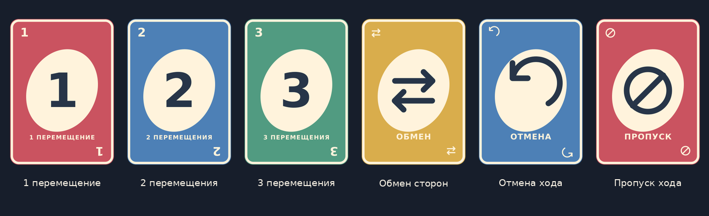

# ChessCards — Королевский двор

Прототип Unity: шахматы управляются картами, а награда за победы позволяет восстановить разрушенный двор.

**Это полноценная папка проекта Unity.** После клонирования не нужно создавать новый проект, копировать Assets или собирать сцену вручную.

## Открыть в Unity

1. Склонируй репозиторий через GitHub Desktop (**File → Clone repository**) либо через Git:

   ```bash
   git clone https://github.com/AngellGirll/ChessCards.git
   ```

   Другой вариант: **Code → Download ZIP**, затем распаковать архив.

2. Открой **Unity Hub → Projects → Add → Add project from disk**. В некоторых версиях Hub эта команда находится в меню рядом с **Open**.
3. Выбери **корневую папку ChessCards**, внутри которой лежат `Assets`, `Packages`, `ProjectSettings`.
4. Открой проект редактором **Unity 6.6, 6000.6.8f1** — эта версия записана в `ProjectSettings/ProjectVersion.txt`. При необходимости Hub предложит установить редактор. Это выбранная версия проекта, а не утверждение, что запуск в ней уже проверен.
5. Дождись импорта и компиляции. В окне **Project** открой `Assets → ChessCards → Scenes` и дважды нажми **Main**.
6. Открой вкладку **Game** и нажми треугольник **Play** вверху редактора.
7. Во дворе нажми **«ИГРАТЬ»**.

Версия проекта совпадает с установленной у пользователя Unity 6000.6.8f1. Запуск в этом редакторе ещё требует проверки; изменение ProjectVersion само по себе не заменяет импорт и миграцию проекта в Unity. Версия [6000.6.8f1 на сайте Unity](https://unity.com/releases/editor/whats-new/6000.6.8f1).

## Уже настроено

- Стартовая сцена `Assets/ChessCards/Scenes/Main.unity`, включённая в список сборки.
- Компонент `ChessCardsApp` и камера в сцене.
- Ввод **Input Manager (Old)** (`activeInputHandler: 0`): прототип использует IMGUI.
- Автоматическая ориентация мобильного экрана и компоновки 9:16 / 16:9.
- Необходимые встроенные модули Unity в `Packages/manifest.json`.
- Метаданные `.meta` для всех ассетов, включая шрифт и изображения.
- `.gitignore` для служебных папок Unity и локальных сборок.

Canvas, EventSystem, сторонние игровые библиотеки и ручное назначение ссылок в Inspector не требуются.

## Что есть в прототипе

- Доска 8×8 со стандартной расстановкой и локальный бот.
- Карты 1–3: столько последовательных шахматных перемещений, сколько указано на карте.
- Совпадение карт по цвету или значению/эффекту, добор, колода и сброс.
- Обмен сторон с переворотом доски, отмена перемещения и пропуск очереди.
- Шах прерывает серию; мат завершает партию.
- Рокировка, взятие на проходе и выбор превращения пешки.
- Награда 100 монет за победу.
- Двор со свободным выбором ремонта: скамейка, фонарь, дом.
- Сохранение монет, побед и ремонта между запусками.
- Встроенный экран правил.

Это одна повторяемая партия и одна локация. Кампании уровней, сетевой игры и финальной графики пока нет.

## Визуал карт



Числовые карты и три специальных эффекта оформлены отдельными лицевыми сторонами: округлённые края, четыре цвета, крупные значения и символы. Доступные карты выделены золотой окантовкой, недоступные приглушены. Рубашка показывает карты бота; перед действием бота его карта появляется в области над рукой. На телефоне доска немного уменьшена, чтобы карты сохраняли вертикальные пропорции.

PNG находятся в `Assets/ChessCards/Resources/ChessCards/Cards`, исходники SVG — в `ArtSource/Cards`. Импорт сторонних графических пакетов не нужен.

## Управление

Нажми доступную карту → свою фигуру → подсвеченную клетку. Можно двигать одну фигуру несколько раз. Если нет подходящих доступных карт, нажми **«Взять карту»**. Руку листают стрелки. При превращении пешки появляется выбор фигуры.

После победы вернись во двор и оплати ремонт. Незавершённая партия при закрытии приложения не сохраняется.

Перед ответом бота есть пауза. Бот сначала показывает карту на цветной плашке и лишь затем применяет эффект; отдельные перемещения выполняются с задержкой. Поэтому «Обмен» и «Отмена» не должны менять доску без предварительного объявления.

Кнопка **«История»** вверху партии показывает последние 60 записей: карты, перемещения, отмены и пропуски. Пока история или правила открыты, бот приостановлен; закрытие окна не вызывает мгновенного ответного действия.

## Сборка для ПК / Android

1. Установи нужный модуль платформы в Unity Hub. Для Android — Android Build Support с SDK/NDK и OpenJDK.
2. Открой **File → Build Profiles**.
3. Выбери платформу, переключись на неё и проверь, что `Main` включена в список сцен.
4. Для тестирования используй **Development Build → Build / Build And Run**.

Готовые EXE/APK не входят в репозиторий. Для iOS понадобятся macOS/Xcode и отдельная проверка.

## Если не запускается

| Симптом | Что сделать |
|---|---|
| Unity Hub не видит проект | Выбирать папку, содержащую сразу Assets, Packages и ProjectSettings |
| Открыта пустая сцена | Дважды нажать `Assets/ChessCards/Scenes/Main.unity` |
| Кнопки не нажимаются | Проверить Edit → Project Settings → Player → Other Settings → Active Input Handling = Input Manager (Old) |
| Не появилась сцена или её случайно удалили | В меню Chess Cards выбрать Create Prototype Scene; это создаст новую сцену |
| Красные ошибки в Console | Сначала исправить первую ошибку; для диагностики сохранить её полный текст и версию Unity |

## Проверки

- Игровая логика: 3371 утверждение, в том числе perft до глубины 4, специальные ходы, гибридные правила и 8 завершённых партий ботов.
- Runtime-код: отдельная проверка через адаптер, включая нажатия, выдачу награды, ремонт и сохранение.
- Структура Git-проекта: проверка наличия настроек, сцены, ссылок GUID, ассетов и `.meta`.

**Unity Editor в рабочей среде отсутствует.** Реальный импорт сцены, компиляция в Unity, мышь/касания и сборки под устройства здесь не проверялись. Автоматические проверки не заменяют этот шаг.

Подробности: [VALIDATION.md](Documentation/VALIDATION.md). Правила и структура кода: [PROTOTYPE_DETAILS_RU.md](Documentation/PROTOTYPE_DETAILS_RU.md).

Для повторения проверок из корня проекта нужны .NET 8 SDK и Python 3:

```bash
python3 Validation/check_project.py
dotnet run --project Validation/ChessCards.Validation.csproj -c Release
dotnet run --project Validation/UiSmoke.csproj -c Release
```

## Лицензии

Шрифт DejaVu Sans и растровые шахматные иконки на его основе поставляются с [лицензией шрифта](Assets/ChessCards/Resources/ChessCards/FONT_LICENSE.txt). Открытая лицензия на игровой код этим README не предоставляется.
